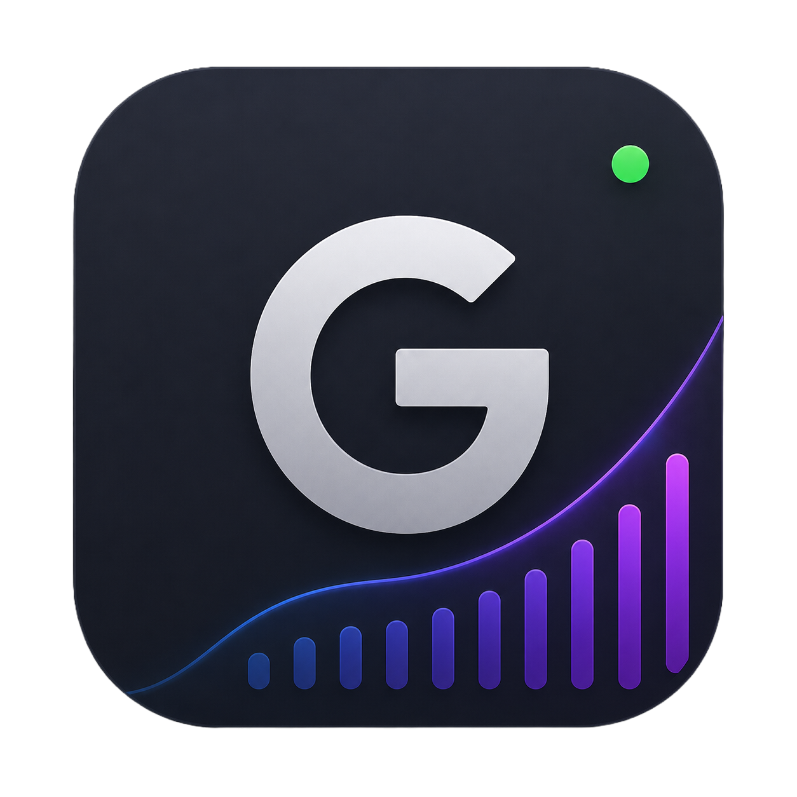

<p align="center">
  
</p>

<h1 align="center">Glance</h1>

<p align="center">
  <strong>A native macOS desktop dashboard for developers.</strong><br/>
  GitHub activity, Docker containers, and SSH servers — all in one glance.
</p>

<p align="center">
  <a href="https://github.com/veyselaksin/glance/actions/workflows/ci.yml"></a>
  <a href="https://github.com/veyselaksin/glance/releases/latest"></a>
  <a href="https://github.com/veyselaksin/homebrew-tap"></a>
  <a href="#"></a>
  <a href="#"></a>
  <a href="#"></a>
  <a href="./LICENSE"></a>
</p>

<p align="center">
  Built with <a href="https://wails.io">Wails</a> (Go backend + React/TypeScript
  frontend) and tuned for macOS: transparent titlebar with floating traffic
  lights, vibrancy, and a dark, material-inspired UI.
</p>

---

> **Glance** — *see* what matters, skip the rest. Your GitHub commits, local
> Docker fleet, and SSH boxes, surfaced on a single, quiet dashboard that
> actually feels like it belongs on a Mac.

## Features

- **Overview** — a single screen combining today's GitHub activity, your
  latest commits, local Docker status, and your primary server's health, with
  a "Needs attention" list for anything that's off.
- **GitHub** — commits pushed today on **every branch** (not just `main`),
  plus GitHub's contribution count. An **Activity** view shows your commit
  history for today / 7 / 30 / 90 days: a daily chart, a per-repository
  breakdown (click a repo to filter) and a list of commits that open on
  github.com. Covers your own, collaborator and organization repos, public
  and private. Sign-in uses GitHub's
  [Device Flow](https://docs.github.com/apps/building-oauth-apps/authorizing-oauth-apps/#device-flow)
  (no client secret, no password); the token lives in the macOS Keychain.
- **Docker** — list containers with state, status, CPU and memory usage;
  stream logs, start / stop / restart / delete containers. If the daemon is
  down, Glance can launch Docker Desktop, OrbStack or Colima for you.
- **Servers** — save SSH-reachable hosts (password or private-key auth),
  open an in-app terminal ([xterm.js](https://xtermjs.org)), and pull live
  server metrics (CPU / memory / disk). Private keys are stored in a
  dedicated key directory, never inline in the config.
- **Server ping** — ICMP and HTTP health checks for any host.
- **Appearance** — light, dark, or follow macOS.
- **Docs** — built-in reference for the bundled commands and conventions.

## 🚀 Installation

You can easily install Glance on macOS using **Homebrew**. Thanks to our automated custom Tap, you don't need to worry about manual downloads or macOS Gatekeeper permission prompts.

Run the following commands in your terminal:

```bash
# 1. Add the custom Homebrew tap
brew tap veyselaksin/tap

# 2. Trust the tap (Required for custom third-party taps)
brew trust veyselaksin/tap

# 3. Install Glance as a macOS Cask
brew install --cask glance
```

## Requirements

- macOS 12 or newer (the UI is tuned for Mac; Linux/Windows builds are
  possible with Wails but untested here)
- [Go](https://go.dev) 1.25+
- [Node.js](https://nodejs.org) 18+ with npm
- The [Wails CLI](https://wails.io/docs/gettingstarted/installation): `go install github.com/wailsapp/wails/v2/cmd/wails@latest`
- Docker (only if you want the Docker tab to talk to a local daemon)

## Getting started

```bash
git clone https://github.com/veyselaksin/glance.git
cd glance
wails dev
```

`wails dev` runs a Vite dev server with hot reload for the frontend. A second
dev server at <http://localhost:34115> lets you call the bound Go methods
from browser devtools.

## Building

To produce a redistributable, production-mode bundle:

```bash
wails build -platform darwin/universal
```

The `.app` lands in `build/bin/`.

## Releasing

The version lives in one place: `info.productVersion` in `wails.json`. It is
written into the app bundle and shown in Settings → About.

1. Bump `info.productVersion` and add an entry to [`CHANGELOG.md`](./CHANGELOG.md).
2. Merge to `main` and tag it:

   ```bash
   git tag v1.1.0
   git push origin v1.1.0
   ```

The [release workflow](.github/workflows/release.yml) then builds a universal
macOS app, ad-hoc signs it, publishes `Glance-macOS.zip` to GitHub Releases,
and bumps the cask in [`veyselaksin/homebrew-tap`](https://github.com/veyselaksin/homebrew-tap)
so `brew upgrade --cask glance` picks it up.

## Project structure

```
main.go                Wails entrypoint; window + macOS options
api/                   Thin services bound to the frontend (GitHub, Docker, SSH, settings)
internal/
  github/              Device Flow, today's stats, multi-branch commit activity
  docker/              Docker Engine client; detects and launches the daemon
  sshx/                SSH sessions, terminal, server metrics
  netcheck/            ICMP / HTTP health checks
  poller/              Background refresh loop feeding the dashboard
  config/              config.json load / save / migration
  secrets/             macOS Keychain storage
  bridge/              Wails runtime events
frontend/src/
  app/                 Shell, sidebar layout, Overview / Settings / Logs / Docs views
  modules/github/      Sign-in, GitHub page, activity (chart, repos, commits)
  modules/docker/      Containers table and daemon controls
  modules/ssh/         Server list, terminal, metrics
  components/          Shared UI (groups, icons, theme switcher, toasts)
frontend/wailsjs/      Generated bindings to the Go backend
build/                 Platform packaging assets (appicon, Info.plist)
```

## Configuration

On first launch Glance writes `~/.glance/config.json`. It stores:

- `github_username` — your signed-in GitHub login (the token is in the Keychain)
- `client_id` — optional override for the embedded OAuth Client ID (see below)
- `server_host` — the host shown on the overview dashboard
- `servers` — saved SSH servers (passwords are in the Keychain; private keys
  live in the key directory)
- `docker_socket` — path to the Docker socket, defaults to the system one
- `theme` — `light`, `dark` or `system`

Tokens and passwords from older versions that were stored in `config.json`
are moved to the Keychain automatically on first launch.

## Security notes

- **GitHub OAuth**: the embedded `DefaultClientID` in
  `internal/github/client.go` is a *public* identifier only — the Device Flow
  does not use a client secret, so it is safe to ship in an open-source
  binary. It must be an **OAuth App** (`Ov23…`) with Device Flow enabled and
  the `read:user repo` scopes; a GitHub App (`Iv23…`) token can only see repos
  the app is installed on, so commits would read 0. Forks can create their own
  OAuth App and either change the constant or set it in GitHub → Advanced.
- **GitHub token**: stored in the macOS Keychain (service `dev.glance`), never
  on disk. Disconnecting from the GitHub page deletes it.
- **SSH credentials**: passwords are stored in the macOS Keychain; private
  keys are written to a dedicated, access-restricted key directory and
  referenced by path. Anyone with read access to that directory can
  impersonate your servers — protect it accordingly.

## Tech stack

- Backend: Go 1.25, Wails v2.12
- Frontend: React 18, TypeScript 5, Vite 5, Tailwind CSS, lucide-react, xterm.js
- Integrations: GitHub REST/GraphQL API, Docker Engine API, golang.org/x/crypto/ssh, macOS Keychain (go-keyring)

## Contributing

Contributions are welcome. Please open an issue first for non-trivial changes
so we can align on direction before you spend time on a PR.

## License

[MIT](./LICENSE) © Veysel Aksin
